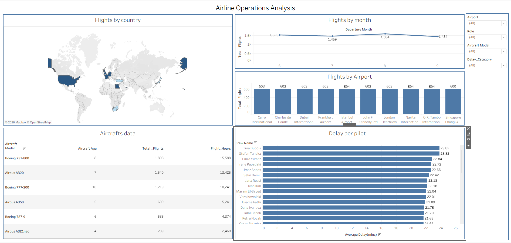

# Airline Operations Analysis

**Tools:** SQL (PostgreSQL) · Tableau  
**Project type:** Aviation and flight-operations case study

## Project Overview

This project explores flight activity and operational patterns for a fictional airline network. SQL was used to combine information from flight, aircraft, airport, and crew tables into an analysis-ready dataset. Tableau was used to present the results in an operations dashboard.

## Business Questions

The case study focuses on the following questions:

- How is flight activity distributed across the year?
- Which airports are the busiest?
- Which aircraft models are used most frequently?
- Are certain pilots or crew members logging significantly more flight hours?
- Are delays concentrated around particular pilots, crews, airports, aircraft models, or countries?
- What other useful operational insights can be identified?

## Data Sources

The SQL query combines data from these source tables:

- `project_three.flights_fact`
- `project_three.aircraft`
- `project_three.airports` (used for origin, destination, and crew base)
- `project_three.flight_crew_fact`
- `project_three.crews`

## SQL Work

The query uses:

- `LEFT JOIN` to combine flight, aircraft, airport, and crew information.
- `CONCAT` to create crew member names.
- `DATE_PART` and `EXTRACT` to derive departure month, aircraft age, and flight duration.
- `CASE WHEN` to classify flight delays into categories.
- An ordered result set using `ORDER BY flight_id`.

The full query is available here: **[SQL/airline_analysis.sql](SQL/airline_analysis.sql)**.

## Data Modeling and Validation

The case study documents the process of inspecting and exploring the available flight, crew, aircraft, and airport data, followed by structuring the relationships for analysis.

Validation activities described in the case study include:

- Checking JOIN keys and table relationships.
- Checking NULL and missing values.
- Checking duplicates in relation to the dataset grain.
- Cross-checking dashboard KPIs and aggregations.
- Reviewing unexpected patterns, anomalies, and calculated-field/business-logic checks.

**Granularity note:** `flight_crew_fact` can create multiple crew-level rows for one flight. The combined dataset therefore retains crew detail, while Tableau FIXED LOD calculations were used for flight-level calculations where needed.

## Dashboard Preview



The dashboard includes:

- **Flights by country:** geographic distribution of flights.
- **Flights by month:** flight volume by departure month.
- **Flights by airport:** comparison of flight volume across airports.
- **Aircraft data:** aircraft model, aircraft age, total flights, and flight hours.
- **Delay per pilot:** average delay by crew member.

Dashboard filters include airport, crew role, aircraft model, and delay category.

## Tools and Techniques

- **SQL:** joins, date/time functions, string concatenation, conditional logic.
- **Tableau:** dashboard development, filters, calculated fields, and FIXED LOD expressions.
- **Analysis workflow:** business-question definition, data inspection, data preparation, data modeling, validation, and visualization.

## Repository Contents

```text
Airline-Operations-Analysis/
├── README.md
├── SQL/
│   └── airline_analysis.sql
└── images/
    └── airline_dashboard.png
```

## Note

The dashboard is provided as a static image preview; this repository does not contain an interactive Tableau Public link.

Before making this repository public, confirm that the dataset, dashboard screenshot, SQL, and any related case-study material are permitted for public sharing and do not expose confidential or personal information.
